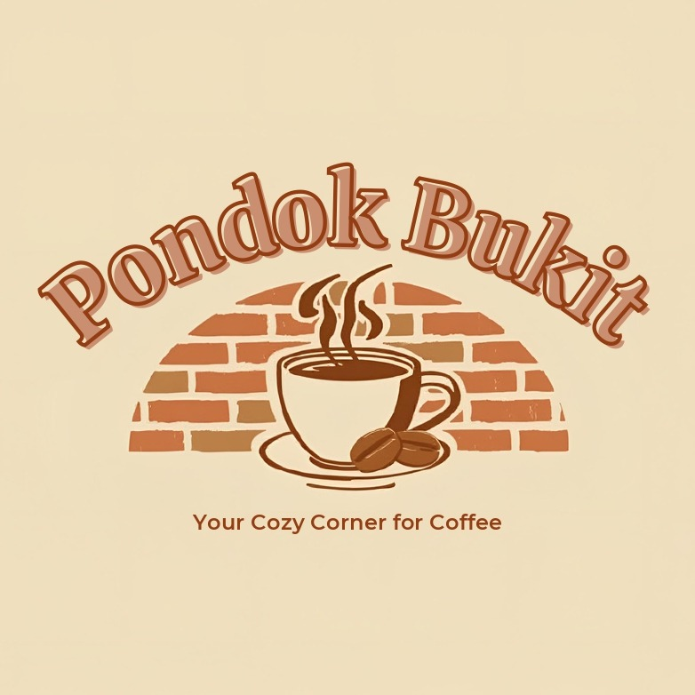

# ☕ Pondok Bukit Coffee Shop — Android App
> **Final Project — Mobile Application Development (MAD)**  
> *"Your Cozy Corner for Coffee"*

  

---

## 📌 Ringkasan Proyek
Aplikasi Android pemesanan kopi untuk **Pondok Bukit Coffee Shop**.  
Aplikasi ini dikembangkan untuk mengatasi permasalahan antrean panjang, kesulitan pelanggan melihat menu ter-update, serta risiko kesalahan pencatatan pesanan manual.

---

## 👥 Dua Peran Pengguna (Multi-Role)
1. **User (Pelanggan):**
   - Registrasi & Login.
   - Melihat katalog menu dengan filter kategori.
   - Kustomisasi pesanan (Ukuran cup, variasi topping, catatan pesanan).
   - Keranjang belanja (*Cart*) & Checkout (*Dine-in* atau *Pickup*).
   - Riwayat pesanan (*Order History*) dan pemantauan status secara *real-time*.

2. **Admin (Pengelola Toko / Barista):**
   - Login khusus akun admin.
   - Melihat pesanan masuk secara *real-time*.
   - Mengubah status pesanan (`Diproses` $\rightarrow$ `Siap` $\rightarrow$ `Selesai`).
   - Kelola katalog menu (*opsional/fitur lanjutan*).

---

## 🛠️ Tech Stack & Syarat Dosen

| Komponen | Implementasi |
|---|---|
| **Platform** | Android (Java / XML Layout) |
| **Arsitektur Halaman** | Multi-Activity dengan Intent (9 Activity) |
| **Autentikasi & Database** | Firebase Authentication & Cloud Firestore (Real-time sync) |
| **Komponen Form (Wajib)** | - **Text Input:** Email, Nama, Catatan, Nomor Meja/Pickup - **Password:** Password field dengan hide/unhide - **Selection:** Spinner Kategori Menu & Pilihan Ukuran Cup - **Checkbox/RadioButton:** RadioButton (Dine-in/Pickup) & Checkbox (Topping/Add-ons) - **Button:** Login, Register, Add to Cart, Checkout, Update Status |

---

## 👨‍💻 Pembagian Tugas Tim (3 Anggota)

- **Orang 1 (Auth, Alur Pemesanan & Design Theme Lead):**
  - Tema aplikasi dasar (`colors.xml`, `themes.xml`, `dimens.xml`, custom drawables)
  - Halaman Login & Register + Role routing logic
  - Keranjang belanja (*Cart*) & Checkout
  - Logout

- **Orang 2 (Firebase Setup & Katalog Menu):**
  - Setup Firebase Project, Security Rules, & kontrak data Firestore
  - Seed data katalog menu & akun default admin
  - Halaman Menu List (RecyclerView & Category Filter)
  - Halaman Detail Menu (Customization options)
  - Polish UI

- **Orang 3 (Admin, Riwayat Pesanan & Laporan):**
  - Halaman Riwayat Pesanan (*Order History*) untuk User
  - Halaman Manajemen Pesanan Masuk (*Admin Order List*) + Update Status
  - Halaman Kelola Menu Admin (*Admin Menu* - opsional)
  - Penyusunan dokumen Laporan Akhir & Link demo video cadangan

---

## 🌿 Strategi Branch Git

- `main` $\rightarrow$ Branch utama yang stabil (production ready)
- `feature/orang-1-auth-checkout` $\rightarrow$ Pengerjaan oleh Orang 1
- `feature/orang-2-firebase-menu` $\rightarrow$ Pengerjaan oleh Orang 2
- `feature/orang-3-admin-history` $\rightarrow$ Pengerjaan oleh Orang 3

---

## 📅 Roadmap 7 Hari

- **Hari 1:** Setup Repo GitHub, Setup Firebase Console, Kontrak Data Firestore, Layout Login & Register.
- **Hari 2:** Logika Login & Register, Seed Data Menu & Admin, Security Rules, Layout Halaman Lain.
- **Hari 3:** Logout, Logika Katalog Menu & Detail Menu, Logika Admin Order List.
- **Hari 4:** Logika Keranjang (Cart), Ubah Status Pesanan oleh Admin, Riwayat Pesanan User.
- **Hari 5:** Logika Checkout, Polish UI & Animasi, Admin Menu (Opsional).
- **Hari 6:** Merge seluruh branch ke `main`, testing end-to-end (2 perangkat), tangkapan layar (screenshot), penulisan laporan.
- **Hari 7:** Bug fixing, build APK release, finalisasi PDF laporan, latihan demo presentasi & rekam video cadangan.
